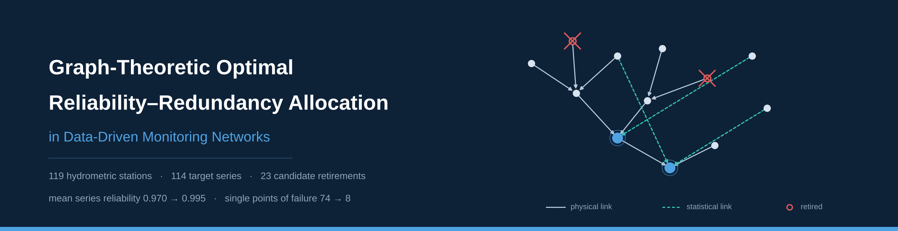
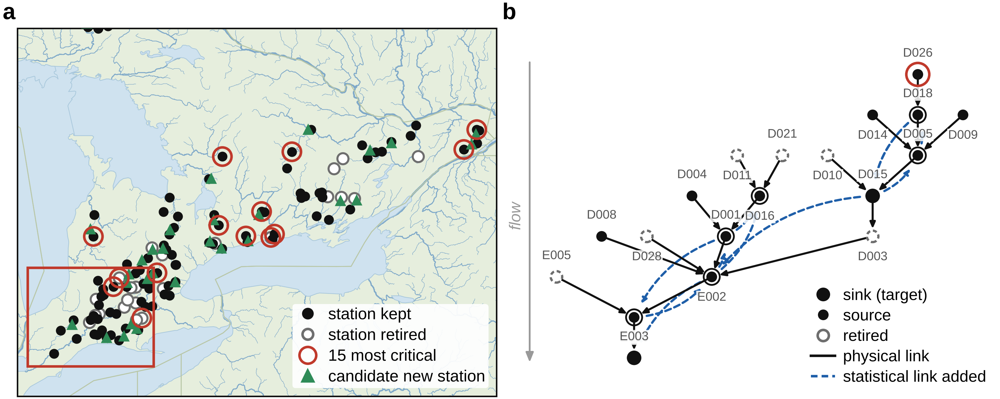
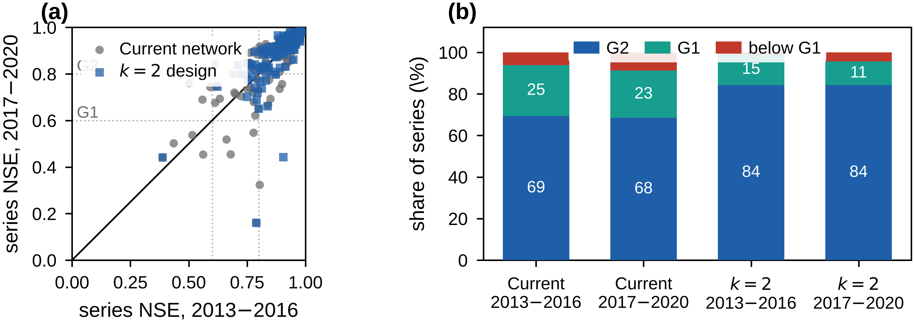

<p align="center">
  
</p>

<p align="center">
  <a href="#data"></a>
  <a href="#code"></a>
  <a href="#license"></a>
  <a href="#license"></a>
</p>

# Graph-Theoretic Optimal Reliability–Redundancy Allocation in Data-Driven Monitoring Networks

Data and code for the paper *Graph-Theoretic Optimal Reliability–Redundancy Allocation in
Data-Driven Monitoring Networks: An Ontario Hydrometric Case Study*.

## Summary

A monitoring network is modelled as a directed graph whose inputs are stations and whose targets
are the measured series. For dendritic flow systems the station-level graph is a forest of in-trees,
on which redundancy allocation reduces to a *k*-multicover with a multi-state performance
constraint: NP-hard in general, solved exactly on trees.

The result is that **predictive relationships between stations can act as engineering redundancy**.
A station that cannot be duplicated can still be made redundant, by arranging for its series to be
reconstructable from stations that remain. Almost all of the attainable gain comes from those
learned relationships rather than from the flow topology.

## Key results

| | Current network | Physical links only | Recommended design |
|---|---|---|---|
| Stations retired | 0 | 9 | **23** |
| Estimator links added | 0 | 32 | **109** |
| Mean series reliability | 0.970 | 0.970 | **0.995** |
| Days with every series served | 29.3 % | 31.8 % | **69.2 %** |
| Series with a single point of failure | 74 | 65 | **8** |
| Unserved target-days per 10⁴ | 6.35 | 4.93 | **0.16** |

On a quarter of the record held out of every design step, 95.6 % of series stayed at the lower
service state, against 91.2 % for the current network.

## The recommended design

<p align="center"></p>

*Figure 14 of the paper.* (a) Station status and candidate sites for new stations.
(b) Graph of the river system boxed in (a): solid edges are physical links, dashed edges are the
statistical links the design adds.

## Held-out validation

<p align="center"></p>

*Figure 15 of the paper.* Series skill on the selection period against the held-out period, and the
share of series by service state. Nothing was re-fitted or re-selected on 2017–2020.

## Repository layout

```
data/      S1–S7, the graph, the pools and the recommended design as CSV
code/      analysis, allocation and figure scripts
  core/    the reliability and allocation package (rv4) and the data layer (ssopt)
  validation/   blocked-CV tables and the held-out skill test
  supplementary/ builds the S1–S7 package
figures/   selected figures as PNG
assets/    repository banner
```

<a name="data"></a>
## Data

| File | Rows | Contents |
|---|---|---|
| `S1_stations.csv` | 119 | role, in-tree, coordinates, availability, MTBF, MTTR, kept or retired |
| `S2_physical_edges.csv` | 88 | station-level physical links, flagged for membership of the forest |
| `S3_series_edges.csv` | 850 | series-level candidate edges: type, training correlation, use in the design |
| `S4_recommended_design.csv` | 114 | the input set of every target series |
| `S5_pool_adjacency.csv` | 119 × 114 | incidence matrix of the candidate pools |
| `S6_design_comparison.csv` | 9 | every design with its reliability, service and structural measures |
| `S7_heldout_skill.csv` | 228 | per-series NSE on the selection and held-out periods |

Station records are the property of the Water Survey of Canada and are **not** redistributed here.
Every station is identified by its WSC gauge number, so the records can be obtained from the
agency and joined on that key.

Periods: models are fitted on 2005–2012 and scored on 2013–2016; 2017–2020 is the held-out test
portion, read once; 2021–2025 is withheld by the data owner and was not used at any stage.

<a name="code"></a>
## Reproducing

```bash
python -m venv .venv && source .venv/bin/activate
pip install -r requirements.txt

python code/core/s0_designs_ms.py        # exact ILP and tree DP designs
python code/core/s2_verify_repair.py run # four-model verification and repair
python code/s29_master.py                # one evaluation pipeline for every design
python code/validation/v10_heldout_skill.py   # held-out test, run once
python code/nfig_a.py                    # figures
```

`code/s29_master.py` is the single evaluation pipeline: every design in the paper is scored under
one failure law and one set of bootstrap resamples, which is what makes the confidence intervals in
Table 1 and Table 2 comparable.

## Citation

```bibtex
@article{monitoring_rrap_2026,
  title   = {Graph-Theoretic Optimal Reliability--Redundancy Allocation in Data-Driven
             Monitoring Networks: An Ontario Hydrometric Case Study},
  author  = {Author, First and Author, Second and Author, Third},
  journal = {Reliability Engineering \& System Safety},
  year    = {2026}
}
```

<a name="license"></a>
## Licence

Code is released under the MIT licence. The derived data tables in `data/` are released under
CC BY 4.0. The underlying station records remain the property of the Water Survey of Canada.
